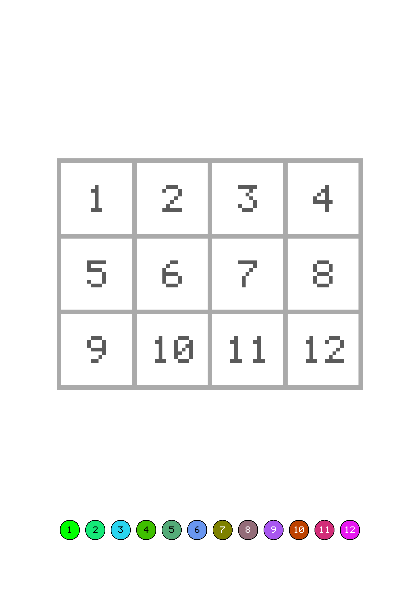

# trixelate

[](https://github.com/Maeevick/trixelate/actions/workflows/ci.yml)
[](LICENSE)


**Any picture, turned into a colour-by-number pixel sheet ready to print.**

trixelate reads a PNG, simplifies it into a grid of square cells, finds its dominant colours and writes a page where every cell carries the number of its colour, with a legend of coloured bubbles at the bottom. The child colours each cell with the crayon its number points to, and the picture appears in pixel art.



## Why

- **Made for children**: big square cells outlined in light grey, numbers in dark grey rather than black, and a legend whose numbers stay readable on dark and light bubbles.
- **Ready to print**: A3, A4 or A5 at 300 dots per inch, the resolution written in the PNG so the printer keeps the paper's size.
- **Safe by default**: a sheet that would not fit, cells too small for their numbers or a margin too wide is refused with what to try instead; an existing sheet is never overwritten without `--force`.
- **Small**: two dependencies, `clap` and `png`; the digits are drawn from a five-by-seven pixel font, with no font file.

## Getting started

```sh
cargo install --path .
trixelate dragon.png --width 32 --height 24 --colours 8
```

```
Sheet written to dragon.sheet.png
```

## The command line

```
trixelate [OPTIONS] --width <WIDTH> --height <HEIGHT> <PICTURE>
```

| Option | Meaning | Default |
| --- | --- | --- |
| `<PICTURE>` | The PNG picture to turn into a sheet, of any colour type and depth | |
| `--width` | Cells across the grid | |
| `--height` | Cells down the grid | |
| `-c`, `--colours` | Colours in the palette, from 2 to 30 (`--colors` works too) | 8 |
| `-f`, `--format` | The paper, upright: `a3`, `a4` or `a5` | `a4` |
| `-m`, `--margin` | The blank paper around the sheet, in millimetres | 20 |
| `-o`, `--output` | Where to write the sheet | beside the picture, as `<picture>.sheet.png` |
| `--force` | Overwrite the sheet if it already exists | |

Exit codes: `0` the sheet is written, `1` the picture or the sheet failed, `2` the arguments are wrong. Errors go to stderr and say what to try.

## How a sheet is made

1. **The picture lies on white paper**: transparent parts become blank, half-transparent ones are washed out on white.
2. **Each cell averages the pixels it covers**, so a detail too small for the grid still tints its cell; a grid finer than its picture repeats its pixels.
3. **The palette is cut from the cells' colours**: the box of colours that spreads the most is cut through the middle of its widest channel until there are as many boxes as colours asked, and each box gives its weighted average. Far-apart colours are never merged, and colour 1 is the one used most.
4. **Every cell takes the number of its nearest palette colour.**
5. **The layout gives the cells the largest square side the page allows**, inside the margin and above the legend, and the largest digits each cell and bubble can hold.

The library behind the command line takes bytes and gives bytes, with no file or terminal in it, so it can later run in a browser as WebAssembly. The words it uses are in the [glossary](GLOSSARY.md).

## Contributing

Issues and pull requests are welcome. Every change comes with its test, and the gate must pass:

```sh
make check     # formatting, lints, tests and no uncovered line but the command line's wiring
make mutants   # whether the tests bite, at the end of a slice
make install   # the command line on this machine
```

The sheet's drawing is pinned by a golden master in `tests/golden`. After a deliberate change to the drawing, look at the new sheet, then write it as the new master with `TRIXELATE_BLESS=1 cargo test --test cli`.

## License

[MIT](LICENSE) © 2026 Aurel | Maeevick
