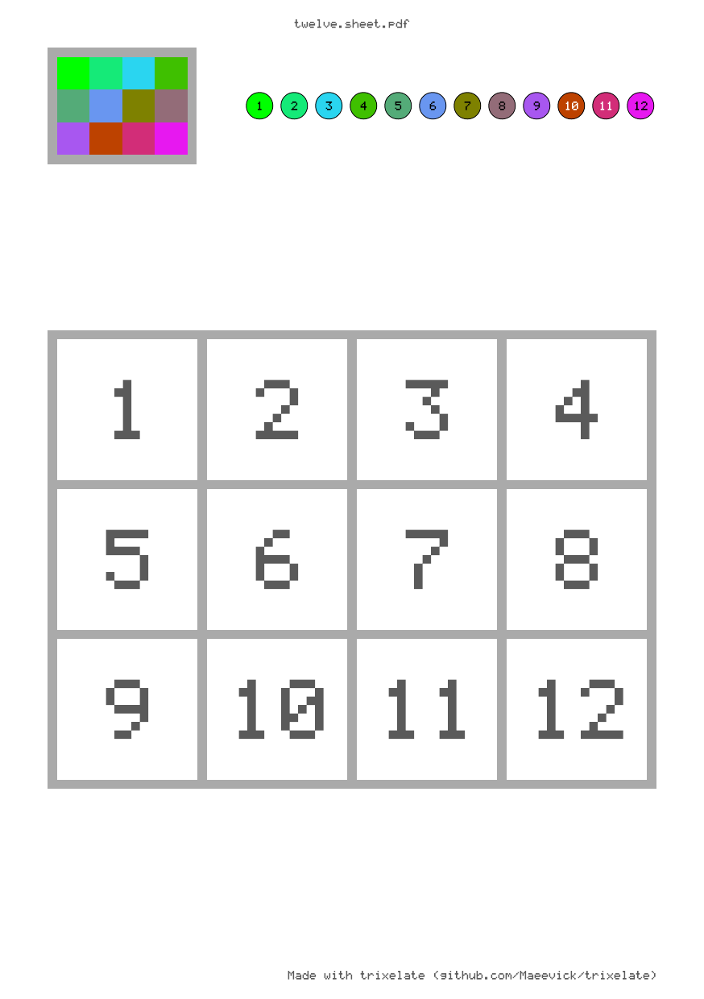

# trixelate

[](https://github.com/Maeevick/trixelate/actions/workflows/ci.yml)
[](LICENSE)


**Any picture, turned into a colour-by-number pixel sheet ready to print.**

trixelate reads a PNG or a JPEG, simplifies it into a grid of square cells, finds its dominant colours and writes a PDF page where every cell carries the number of its colour, with a legend of coloured bubbles. The child colours each cell with the crayon its number points to, and the picture appears in pixel art.

## Why

- **Made for children**: big square cells outlined in light grey, numbers in dark grey rather than black, and a legend whose numbers take black or white, whichever reads better on their bubble.
- **A model to copy from**: every sheet shows the picture in miniature in the page's top left corner, in its colours and without numbers, for the youngest to see what they are making, and is titled with its file name. Its preview shows the whole sheet coloured in, before a single crayon is out.
- **Ready to print**: a PDF drawn in shapes rather than dots, sharp at any size and light without a compressor, on A2, A3, A4 or A5, lying the way the picture suits unless told otherwise; an A2 poster has bubbles twice as wide. The PDF says its title, when it was made and the trixelate that made it, with where its code and page live.
- **Posters from a home printer**: an A2 or A3 also comes cut into the A4 pages its paper is made of, 4 for an A2 and 2 for an A3, in one PDF that prints at actual size. Each piece is marked where to cut it and says its row and column; glued together, the poster is 88% of its paper, its margins and shared strips taking the rest.
- **Safe by default**: a sheet that would not fit, cells too small for their numbers or a margin outside 5 to 20 mm is refused with what to try instead. A picture over 50 megapixels, a file over 100 MB or anything but a file is refused before it is read. No file is ever overwritten, not even through a link: a sheet beside its picture is stamped with the second it was made, and an `--output` that already exists is refused.
- **Small**: the library needs only `png` and `zune-jpeg`, the command line adds `clap`, the page adds Leptos; the digits and letters are drawn from a five-by-seven pixel font, with no font file, and the PDF is written by hand, with no PDF library.

## Getting started

```sh
cargo install --path crates/trixelate-cli
trixelate picture.png -o picture.sheet.pdf
```

```
Sheet written to picture.sheet.pdf in 0.01 s
1,024 cells to colour: at 3 a minute, a five-year-old needs about 5 h 42 min, or 12 afternoons of half an hour, snack breaks not included.
```

## The command line

```
trixelate [OPTIONS] <PICTURE>
```

| Option | Meaning | Default |
| --- | --- | --- |
| `<PICTURE>` | The PNG or JPEG picture to turn into a sheet, of any colour type and depth, up to 50 megapixels and 100 MB, a photo turned upright as its camera says; the sheet, its preview and its pieces are always PDFs | |
| `--width` | Cells across the grid; the rows follow from the picture's proportions, so it is never stretched. At most 80 on A2, 64 on A3, 48 on A4 and 32 on A5 | 64 on A2, 48 on A3, 32 on A4, 24 on A5 |
| `-c`, `--colours` | Colours in the palette, from 2 to 24 (`--colors` works too) | 8 on A2 and A3, 4 on A4 and A5 |
| `-f`, `--format` | The paper: `a3`, `a4` or `a5`, or the poster `a2` | `a4` |
| `--landscape` | Lay the paper on its side | the way the picture suits: on its side once it is a tenth wider than tall, upright otherwise, a square included |
| `--portrait` | Stand the paper upright; not with `--landscape` | the way the picture suits |
| `-m`, `--margin` | The blank paper around the sheet, in millimetres, from 5 for the title and the credit to 20, leaving the room to the cells | 10 |
| `-o`, `--output` | Where to write the sheet: a new file, or a folder to write it in under its default name | beside the picture, named after it, its settings and the UTC second it was made: `goblin-32-4-a4-20261111T142915Z.sheet.pdf`, `goblin-24-12-a5-landscape-20261111T142915Z.sheet.pdf`, numbered `-2`, `-3` after the stamp when sheets made that second took the name |
| `--preview` | Write the sheet's preview instead: the sheet as it looks once coloured in, every cell filled with its colour, named `….preview.pdf` | the sheet to colour in |
| `--pieces` | Write the sheet cut into A4 pieces instead, as one PDF to print at actual size, named `….pieces.pdf`; only on A2 or A3, not with `--preview` | the sheet to colour in |
| `-y`, `--yes` | Go ahead without being asked when warned: under 16 cells across it is big cubes, under 4 colours solid patches, more than pixel art | asks |

Exit codes: `0` the sheet is written, `1` the picture or the sheet failed, or the answer to a warning was no, `2` the arguments are wrong, too many cells across, pieces of an A4 or A5 sheet, or a warning with nobody at a terminal to answer it and no `--yes` included. Errors go to stderr and say what to try.

## In the browser

The same sheets without a command line or a server, the page needing Rust 1.89 rather than 1.88: drop a picture in, set the sheet up, look at it beside your picture, slide the line across it to see it coloured in, then download it as a PDF, and a poster's A4 pieces too. A picture dropped in lays the paper the way it suits, the box left free to change. The picture never leaves the browser, and the browser makes sure of it: the built page's Content-Security-Policy lets it fetch from its own address only, and run only its own script.

```sh
rustup target add wasm32-unknown-unknown
cargo install trunk
make web        # served at http://127.0.0.1:8080, rebuilt on every change
make web-build  # a static site in crates/trixelate-web/dist, for any host; crates/trixelate-csp writes its policy, and the build fails without it
make web-smoke  # the built page opened in a headless Chrome, failing unless it mounts with its policy blocking nothing
```

## How a sheet is made

1. **The picture lies on white paper**: transparent parts become blank, half-transparent ones are washed out on white. A photo is first turned upright as its camera's EXIF orientation says.
2. **The grid keeps the picture's proportions**, its rows following from `--width`, and **each cell averages the pixels it covers**, so a detail too small for the grid still tints its cell; a grid finer than its picture repeats its pixels.
3. **The palette is cut from the cells' colours**: the box of colours that spreads the most is cut through the middle of its widest channel until there are as many boxes as colours asked, and each box gives its weighted average. Far-apart colours are never merged, and colour 1 is the one used most.
4. **Every cell takes the number of its nearest palette colour**, and a colour no cell takes is dropped, so every bubble has cells to colour.
5. **The paper lies the way the picture suits** unless told otherwise: on its side once the picture is a tenth wider than tall, upright otherwise, a square included.
6. **The layout gives the cells the largest square side the page allows**, inside the margin and clear of the legend, and the largest digits each cell and bubble can hold. A grid with more rows than the page could ever number is refused before any cell is coloured.
7. **The model sits in miniature in the page's top left corner**, inside the margin, a block of colour per cell, framed, with no number and no line. It is seven thirty-seconds of the grid's width. Upright, the legend sits in the room right of it, centred on its middle, and the grid is centred in the room below; on its side, the grid is centred above the legend at the bottom. The model lies over the grid where they meet. The sheet is then titled with its file name, as big as the bubbles' numbers.
8. **A small credit is written at the bottom right**, in the margin: made with trixelate, and where it lives.
9. **The page is written as a PDF in shapes**: filled rectangles for the cells, the lines and the miniature, circles of four curves for the bubbles, and each character a form drawn once and placed wherever it is written. It prints sharp at any size and stays light with no compressor, and says its title, when it was made, and the trixelate that made it with where its code and page live.

## How a poster is cut into pieces

1. **A poster takes the A4 pages its paper is made of**: 4 for an A2, the pieces lying as the poster does, and 2 for an A3, the pieces lying the other way. An A4 or A5 prints whole at home.
2. **Each piece prints its part of the poster inside a 10 mm margin**, wider than home printers usually leave unprinted, and shares a 10 mm strip with the pieces to its right and below. For the pieces to stay as many as the pages, the poster shrinks to fit: glued together, it is 88% of its paper.
3. **Cut marks show the left and top edges of each part**, and its row and column are written under it, at the right: `row 2 of 2 - column 1 of 2`.
4. **The pieces come as one PDF, an A4 page each, row after row**, each drawing the poster's own shapes, shrunk and clipped to its window.

Print it at actual size (100%, not "fit to page"). Cut each piece along its marks on the left and top, then glue it over the pieces to its left and above, matching the picture.



The workspace holds the library, `crates/trixelate`, the command line, `crates/trixelate-cli`, the page, `crates/trixelate-web`, and the hook that writes the page's Content-Security-Policy, `crates/trixelate-csp`. The library takes bytes and gives bytes, with no file or terminal in it, so it can also run in a browser as WebAssembly. The words it uses are in the [glossary](GLOSSARY.md).

## Contributing

Issues and pull requests are welcome. Every change comes with its test, and the gate must pass:

```sh
make check                # formatting, lints, tests and no uncovered line but the command line's and the page's wiring
make mutants              # whether the tests bite, at the end of a slice
make install              # the command line on this machine
make web                  # the page, rebuilt on every change
make bump VERSION=0.4.0   # every crate at that version, committed then tagged, never pushed
```

`make check` needs `cargo-llvm-cov` and the `wasm32-unknown-unknown` target. CI also checks every dependency with `cargo deny` against `deny.toml`, weekly too, and every file's licence is recorded in `REUSE.toml`. Security reports go through the [security policy](SECURITY.md).

The sheet's drawing is pinned by golden PDFs in `crates/trixelate-cli/tests/golden`, compared byte for byte but for the moment they were made. After a deliberate change to the drawing, look at the new sheet, rendered with poppler's `pdftoppm` for instance, then write it as the new master with `TRIXELATE_BLESS=1 cargo test -p trixelate-cli --test cli`.

## License

[MIT](LICENSE) © 2026 Aurel | Maeevick

The page's title is set in [VT323](https://fonts.google.com/specimen/VT323) by Peter Hull, under the [SIL Open Font License 1.1](crates/trixelate-web/fonts/VT323-OFL.txt).
