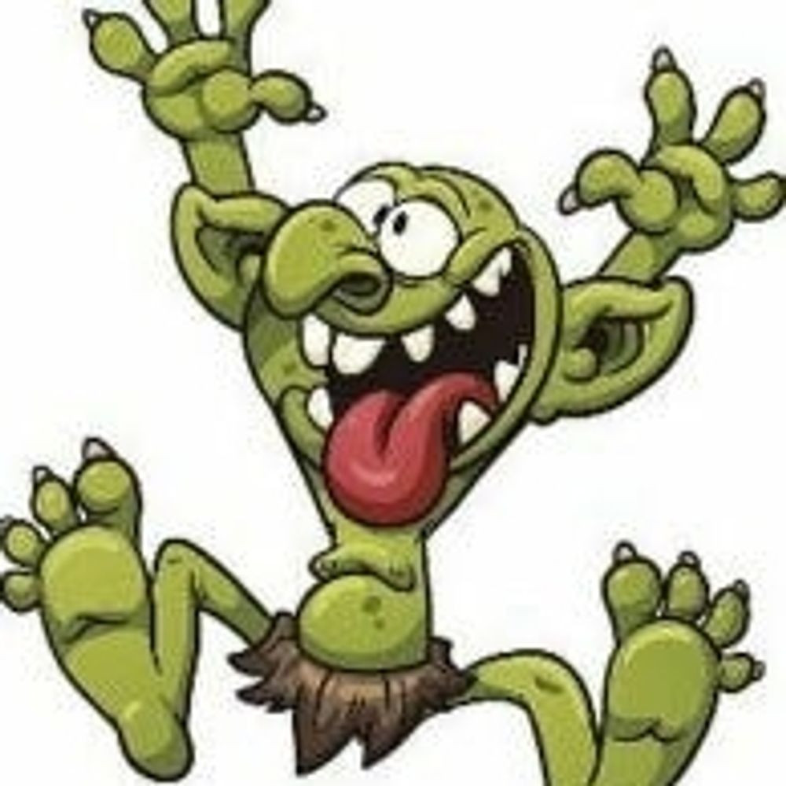
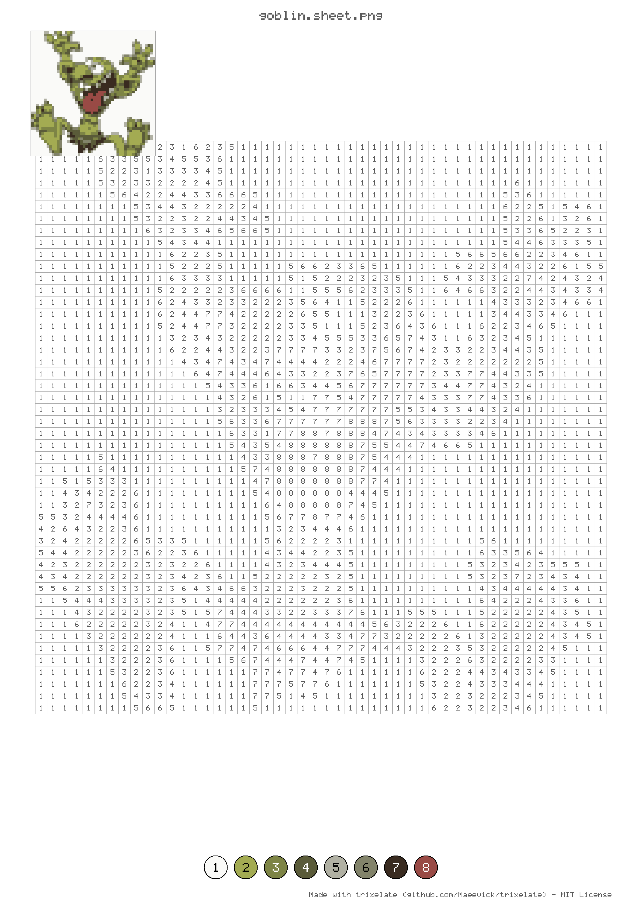
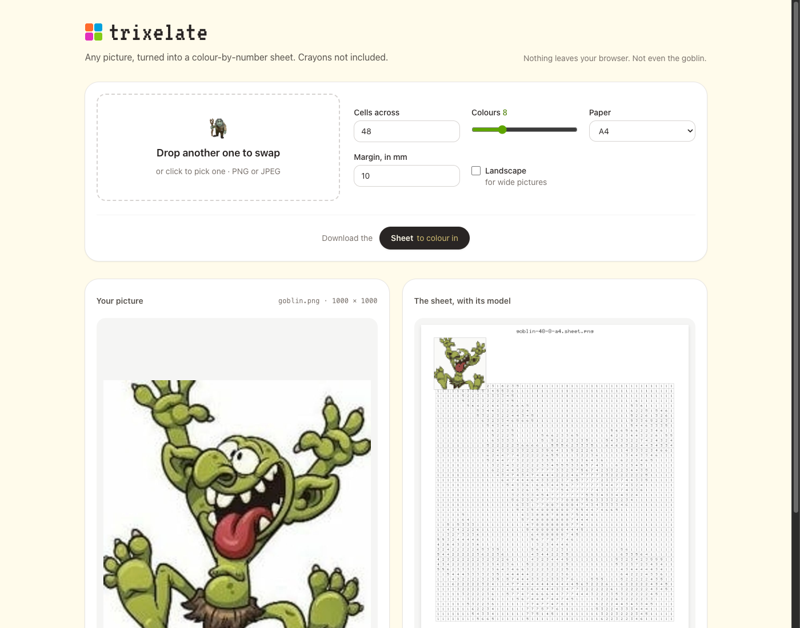
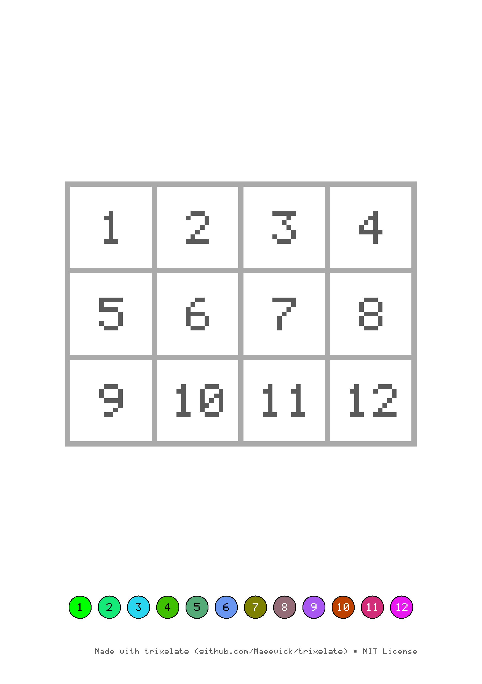

# trixelate

[](https://github.com/Maeevick/trixelate/actions/workflows/ci.yml)
[](LICENSE)


**Any picture, turned into a colour-by-number pixel sheet ready to print.**

trixelate reads a PNG or a JPEG, simplifies it into a grid of square cells, finds its dominant colours and writes a page where every cell carries the number of its colour, with a legend of coloured bubbles at the bottom. The child colours each cell with the crayon its number points to, and the picture appears in pixel art.

## Why

- **Made for children**: big square cells outlined in light grey, numbers in dark grey rather than black, and a legend whose numbers stay readable on dark and light bubbles.
- **A model to copy from**: every sheet shows the picture in miniature in the page's top left corner, in its colours and without numbers, for the youngest to see what they are making, and is titled with its file name.
- **Ready to print**: A3, A4 or A5, portrait or landscape, at 300 dots per inch, the resolution written in the PNG so the printer keeps the paper's size.
- **Safe by default**: a sheet that would not fit, cells too small for their numbers or a margin too wide is refused with what to try instead; an existing sheet is never overwritten without `--force`.
- **Small**: the library needs only `png` and `zune-jpeg`, the command line adds `clap`, the page adds Leptos; the digits and letters are drawn from a five-by-seven pixel font, with no font file.

## Getting started

```sh
cargo install --path crates/trixelate-cli
trixelate sample/goblin.png
```

```
Sheet written to sample/goblin-48-8-a4.sheet.png in 0.05 s
2,304 cells to colour: at 3 a minute, a five-year-old needs about 12 h 48 min, or 26 afternoons of half an hour, snack breaks not included.
```

## The command line

```
trixelate [OPTIONS] <PICTURE>
```

| Option | Meaning | Default |
| --- | --- | --- |
| `<PICTURE>` | The PNG or JPEG picture to turn into a sheet, of any colour type and depth; the sheet is always a PNG | |
| `--width` | Cells across the grid; the rows follow from the picture's proportions, so it is never stretched. At most 64 on A3, 48 on A4 and 32 on A5 | the most the paper holds |
| `-c`, `--colours` | Colours in the palette, from 2 to 24 (`--colors` works too) | 8 |
| `-f`, `--format` | The paper: `a3`, `a4` or `a5` | `a4` |
| `--landscape` | Lay the paper on its side, for wide pictures | upright |
| `-m`, `--margin` | The blank paper around the sheet, in millimetres | 10 |
| `-o`, `--output` | Where to write the sheet | beside the picture, named after it and its settings, so variants never overwrite each other: `goblin-48-8-a4.sheet.png`, `goblin-32-24-a5-landscape.sheet.png` |
| `--force` | Overwrite the sheet if it already exists | |
| `-y`, `--yes` | Go ahead without being asked when warned: under 16 cells across it is big cubes, under 4 colours solid patches, more than pixel art | asks |
| `--chaos` | Go beyond the most cells across, to try what the limits refuse | |

Exit codes: `0` the sheet is written, `1` the picture or the sheet failed, or the answer to a warning was no, `2` the arguments are wrong, too many cells across, or a warning with nobody at a terminal to answer it and no `--yes` included. Errors go to stderr and say what to try.

A goblin turned into a sheet to colour with `trixelate sample/goblin.png`: 48 cells wide, 8 colours, on A4.

| Picture | Sheet |
| --- | --- |
|  |  |

## In the browser

The same sheets without a command line or a server: drop a picture in, set the sheet up, look at it beside your picture, then download it. The picture never leaves the browser.

```sh
rustup target add wasm32-unknown-unknown
cargo install trunk
make web        # served at http://127.0.0.1:8080, rebuilt on every change
make web-build  # a static site in crates/trixelate-web/dist, for any host
```



## How a sheet is made

1. **The picture lies on white paper**: transparent parts become blank, half-transparent ones are washed out on white.
2. **The grid keeps the picture's proportions**, its rows following from `--width`, and **each cell averages the pixels it covers**, so a detail too small for the grid still tints its cell; a grid finer than its picture repeats its pixels.
3. **The palette is cut from the cells' colours**: the box of colours that spreads the most is cut through the middle of its widest channel until there are as many boxes as colours asked, and each box gives its weighted average. Far-apart colours are never merged, and colour 1 is the one used most.
4. **Every cell takes the number of its nearest palette colour**, and a colour no cell takes is dropped, so every bubble has cells to colour.
5. **The layout gives the cells the largest square side the page allows**, inside the margin and above the legend, and the largest digits each cell and bubble can hold.
6. **The model sits in miniature in the page's top left corner**, inside the margin, a block of colour per cell, framed, with no number and no line. It is seven thirty-seconds of the grid's width, over the grid where they meet, the grid staying centred above the legend whichever way up the paper lies. The sheet is then titled with its file name, as big as the bubbles' numbers.
7. **A small credit is written at the bottom right**, in the margin: trixelate and its licence.



The workspace holds the library, `crates/trixelate`, the command line, `crates/trixelate-cli`, and the page, `crates/trixelate-web`. The library takes bytes and gives bytes, with no file or terminal in it, so it can also run in a browser as WebAssembly. The words it uses are in the [glossary](GLOSSARY.md).

## Contributing

Issues and pull requests are welcome. Every change comes with its test, and the gate must pass:

```sh
make check     # formatting, lints, tests and no uncovered line but the command line's wiring
make mutants   # whether the tests bite, at the end of a slice
make install   # the command line on this machine
make web       # the page, rebuilt on every change
```

The sheet's drawing is pinned by golden masters in `crates/trixelate-cli/tests/golden`. After a deliberate change to the drawing, look at the new sheet, then write it as the new master with `TRIXELATE_BLESS=1 cargo test -p trixelate-cli --test cli`.

## License

[MIT](LICENSE) © 2026 Aurel | Maeevick

The page's title is set in [VT323](https://fonts.google.com/specimen/VT323) by Peter Hull, under the [SIL Open Font License 1.1](crates/trixelate-web/fonts/VT323-OFL.txt).
